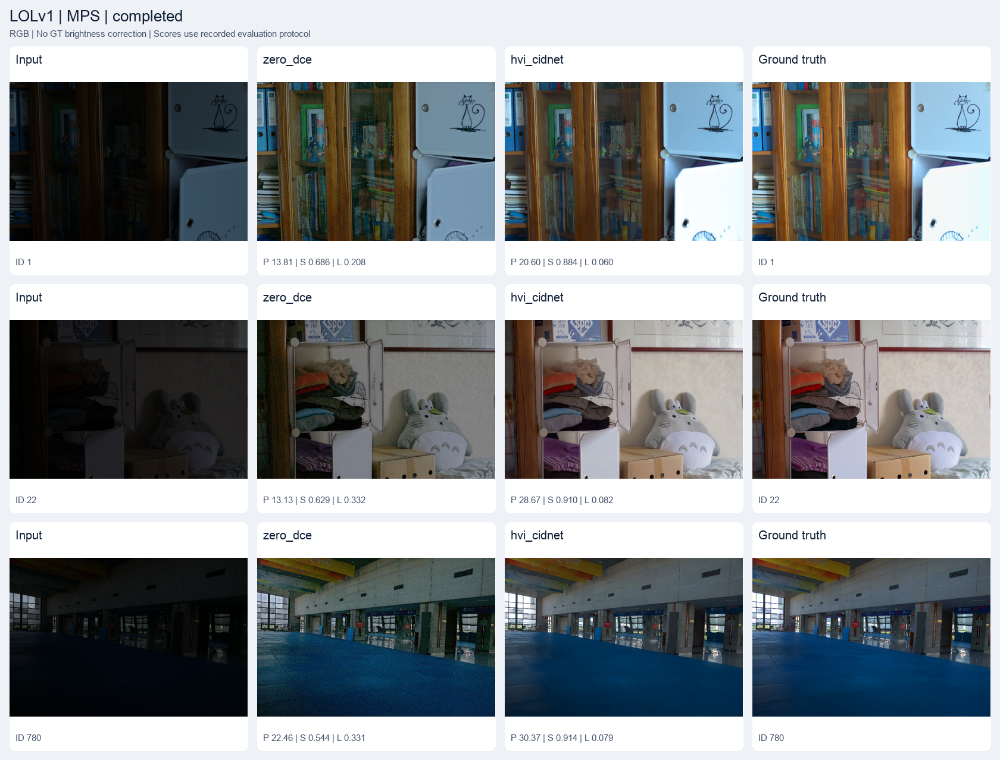

# LowLight-Eval

A small, adapter-based toolkit for benchmarking low-light image enhancement methods with one shared evaluation pipeline.

Run the official **Zero-DCE** and **HVI-CIDNet** implementations on the same paired images, compute **PSNR / SSIM / LPIPS**, record inference latency, and generate comparison figures. The project focuses on inference and evaluation, with **Apple Silicon MPS** support and CPU fallback.

[Chinese guide](README.zh-CN.md) · [Per-image results](examples/lolv1/results.csv) · [Run metadata](examples/lolv1/run.json)

## Results

Measured on **LOLv1 eval15: all 15 paired test images**, using pretrained checkpoints, RGB float32 images in `[0, 1]`, and **no ground-truth mean brightness correction**.

| Method | Checkpoint | PSNR ↑ (dB) | SSIM ↑ | LPIPS ↓ | Mean inference ↓ (s/image) |
| --- | --- | ---: | ---: | ---: | ---: |
| Zero-DCE | Official `Epoch99.pth` | 14.8611 | 0.5591 | 0.3349 | 0.0361 |
| HVI-CIDNet | User-provided `model.safetensors` | 23.6153 | 0.8710 | 0.1061 | 1.3858 |

The complete run took approximately **26.1 seconds** on the tested Mac. Per-image inference timing includes device transfers and adapter processing, with MPS synchronization; it excludes model loading, warmup, metric computation, and file I/O. LPIPS runs on CPU.



The main HVI-CIDNet checkpoint has SHA256 `928bc914bcec03abd6f2b9e057007961845a75e156b0536ba7c41bb4ac817c4c`. Its exact training variant was not supplied, so it is identified by its file hash rather than assigned a variant name. Checkpoints and datasets are not bundled.

A separate run using the author's public **LOLv1 wperc** checkpoint achieved **23.8436 dB / 0.8580 SSIM / 0.0856 LPIPS**. Its [results](examples/lolv1-wperc/summary.csv), [metadata](examples/lolv1-wperc/run.json), and [comparison](examples/lolv1-wperc/comparison.png) are retained separately. Different checkpoints must not be treated as interchangeable.

## Quick start

### 1. Install

Use Python **3.11**. The tested environment is macOS arm64 with PyTorch 2.14.1; exact package versions are recorded in `requirements-lock-macos-arm64.txt`.

```bash
git clone https://github.com/Shao-Jun-han/lowlight-eval.git
cd lowlight-eval
python3.11 -m venv .venv
source .venv/bin/activate
python -m pip install -r requirements.txt
python scripts/prepare_models.py
```

`prepare_models.py` downloads pinned official repository revisions from `sources.json` and the author's public HVI-CIDNet LOLv1 wperc checkpoint. It verifies the HVI checkpoint SHA256 and leaves official network source code unchanged.

The first LPIPS invocation downloads the official pretrained AlexNet backbone, approximately 233 MiB, into `.cache/torch`.

### 2. Configure data and weights

Download LOLv1 from the [dataset authors' project page](https://daooshee.github.io/BMVC2018website/). The default layout is:

```text
workspace/
├── LOLdataset/
│   ├── our485/              # Training split; not used here
│   └── eval15/
│       ├── low/             # 15 low-light images
│       └── high/            # 15 matching reference images
├── model.safetensors        # Optional user-provided HVI checkpoint
└── lowlight-eval/
    └── config.yaml
```

Edit `config.yaml` to set dataset directories and checkpoint paths. Relative paths are resolved against the configuration file, not the terminal's working directory.

**Choose the HVI checkpoint before running:**

- To use the author's checkpoint downloaded by the setup script, set the HVI `weight_path` to `weights/hvi_cidnet_lolv1_wperc.safetensors`.
- To use the checkpoint from the main results, provide that exact file and retain `weight_path: ../model.safetensors`, or configure its actual location.

The Zero-DCE checkpoint is provided by its official repository at `vendor/Zero-DCE/Zero-DCE_code/snapshots/Epoch99.pth`.

`device: auto` selects MPS when available and otherwise CPU. Set `device: cpu` to explicitly use CPU. This version configures MPS and CPU backends.

### 3. Verify and run

```bash
python check_environment.py --check-data
python metrics.py --lpips
python -m unittest discover -s tests -v
```

The dataset check must list **15 pairs**. Missing matches, duplicate image IDs, incorrect pair counts, and mismatched dimensions raise errors.

Start with one image:

```bash
python infer.py --method zero_dce \
  --input ../LOLdataset/eval15/low/1.png \
  --output outputs/zero_dce_single.png
```

Then evaluate the configured methods, or select one explicitly:

```bash
python evaluate.py
python evaluate.py --methods hvi_cidnet
```

Each run creates its own UTC timestamp directory:

```text
outputs/<run_id>/
├── results.csv              # Per-image scores and one mean row per method
├── summary.csv              # Method-level means
├── summary.md               # Markdown result table
├── run.json                 # Configuration, versions, hashes, and sanity checks
└── images/<method>/
    ├── <image_id>.png        # 8-bit visualization
    └── <image_id>.npy        # The float32 array used for evaluation
```

Use `row_type=image` when aggregating `results.csv`; its `row_type=mean` rows must not be counted again. The `weights` column distinguishes pretrained and random-initialized models.

Generate a comparison from the actual run directory printed by the evaluator:

```bash
python visualize.py --run outputs/<run_id> --images 1 22 780
```

Use `--panel-width 600` for larger panels or `--output` to choose a destination.

## Evaluation protocol

- **Inference:** batch size 1, evaluation mode, disabled parameter gradients, and `torch.no_grad()`.
- **Images:** RGB, `H × W × 3`, float32, `[0, 1]`; original resolution, no border crop, and no GT brightness correction.
- **PSNR:** full-image RGB MSE with data range 1; identical images return infinity.
- **SSIM:** one shared scikit-image implementation; 11 × 11 Gaussian window, sigma 1.5, population covariance, averaged across RGB channels.
- **LPIPS:** pretrained AlexNet with `lpips==0.1.4`; inputs are mapped to `[-1, 1]`.
- **Quantization:** float32 outputs are evaluated directly by default. `metrics.quantize_8bit: true` applies the same rounding to 8-bit precision for every method. Report this setting when comparing results.
- **Reproducibility:** seed 42 for Python, NumPy, and PyTorch; fixed CPU thread count; deterministic-algorithm checks with warnings. Hardware and library changes may still introduce small numerical differences.
- **Timing:** one warmup inference per model, followed by synchronized per-image timing. The run metadata also records total wall-clock time.

Zero-DCE returns the official network's eighth curve-iteration result. HVI-CIDNet follows `eval.py --lol`, including saturation gating with the default `alpha_s=1.3`. Its adapter reflect-pads dimensions to multiples of eight and crops predictions back to the original size.

Both `.pth` and `.safetensors` checkpoints are supported. HVI `.safetensors` files are read with `safetensors.torch.load_file(..., device="cpu")` and loaded with `strict=True`.

### Sanity checks and metric interpretation

The configuration checks method-level mean PSNR/SSIM and inference latency. A failed check preserves the available results, records `sanity_failed`, and stops subsequent methods with exit code **2**.

The HVI PSNR range was explicitly revised to **23–25 dB** for this no-GT-correction protocol. The author's higher GT-mean-corrected results use a different evaluation procedure. Do not alter output brightness simply to match a reported number.

Validation records are available in [the current checkpoint report](docs/validation.md) and [the official wperc report](docs/validation-wperc.md). These supporting reports and the code comments are in Chinese.

## Add a method

Create `methods/new_method.py` with exactly two public functions:

```python
def load_model(weight_path, device):
    """Load the official architecture and checkpoint; return an eval model."""
    ...


def enhance(model, img):
    """Return an RGB float32 [0, 1] image with the same shape as img."""
    ...
```

Add a configuration entry:

```yaml
- name: new_method
  module: methods.new_method
  enabled: true
  repo_path: vendor/official_new_method
  weight_path: weights/new_method.pth
```

`repo_path` supplies the official implementation's import root. Add optional `sanity` ranges when a verified reference is available. The evaluator and visualizer do not need method-specific changes. Keep official source untouched; handle preprocessing, checkpoint compatibility, device placement, and output conversion in the adapter. Isolate imports inside the adapter if upstream repositories use conflicting module names.

## Pipeline smoke tests

For an explicitly marked random-initialized HVI pipeline test:

```bash
python scripts/make_smoke_data.py --random-hvi
python evaluate.py --config artifacts/smoke_random.yaml \
  --methods hvi_cidnet --allow-random
```

This uses a separate `SYNTHETIC_SMOKE_TEST` dataset. Random initialization requires both a null checkpoint path and `--allow-random`; missing checkpoint files never silently fall back to random weights. These runs are marked `random_init` and `completed_unvalidated` and are not benchmark results.

## Repository layout

| Path | Purpose |
| --- | --- |
| `config.yaml` | Dataset, device, checkpoint, metric, and sanity settings |
| `dataset.py` | Strict image pairing, RGB loading, validation, and saving |
| `runtime.py` | Configuration paths, seeds, device selection, and adapter loading |
| `methods/` | Official-model adapters and checkpoint utilities |
| `metrics.py` | Shared metrics and metric self-tests |
| `infer.py` / `evaluate.py` / `visualize.py` | Single-image inference, evaluation, and comparison figures |
| `scripts/prepare_models.py` / `sources.json` | Pinned upstream code and checkpoint preparation |
| `tests/` | Evaluation-contract checks |
| `examples/` | Curated real results, figures, and portable run metadata |

The repository excludes `.venv/`, `__pycache__/`, `.cache/`, upstream clones, datasets, checkpoints, raw `outputs/`, and scratch `artifacts/`. Only the latest raw run is retained locally; curated examples are committed separately. Environment files are not uploaded.

## References and upstream terms

- [Zero-DCE](https://github.com/Li-Chongyi/Zero-DCE), CVPR 2020. The upstream README states academic-research use under CC BY-NC 4.0; this project does not change those terms.
- [HVI-CIDNet](https://github.com/Fediory/HVI-CIDNet), CVPR 2025, and its [public LOLv1 wperc checkpoint](https://huggingface.co/Fediory/HVI-CIDNet-LOLv1-wperc).
- [LOLv1 / Deep Retinex Decomposition](https://daooshee.github.io/BMVC2018website/), BMVC 2018.
- [LPIPS / Perceptual Similarity](https://github.com/richzhang/PerceptualSimilarity).

Upstream code, data, and checkpoints retain their respective terms. This release covers inference benchmarking; training, adversarial attacks, and additional adapters are future extensions.
